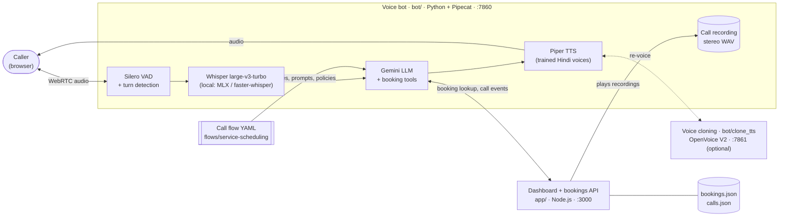

# AMC Cleaning Voice Bot

A Hindi (Hinglish) phone voice agent that schedules and confirms AMC solar panel cleaning visits for SolarSquare customers. Built for the SolarSquare AI Voice Agent Hackathon (tracks #4 slot scheduling and #5 slot confirmation).

Speech recognition and the bot's voice run locally. Gemini, the LLM, is the only cloud call.

## Architecture



## Components

| Part | Folder | Stack |
|---|---|---|
| Voice bot | [bot/](bot/) | Python 3.12, uv, Pipecat, FastAPI/Uvicorn, SmallWebRTC, Silero VAD, Whisper (mlx-whisper / faster-whisper), Gemini, Piper |
| Voice cloning (optional) | [bot/clone_tts/](bot/clone_tts/) | OpenVoice V2 converter, PyTorch 2.6 (MPS), FastAPI |
| Voice training | [bot/voice_training/](bot/voice_training/) | Piper fine-tuning on Google Colab (PyTorch Lightning, espeak-ng) |
| Evals | [bot/eval/](bot/eval/) | STT benchmark and a conversation benchmark with simulated callers (personas in YAML) |
| Dashboard + API | [app/](app/) | Node.js with built-in modules only, JSON file storage, plain HTML/CSS |
| Call flows | [flows/](flows/) | YAML states, intents, policies and Hindi/English prompts; checked by [tools/flowcheck.py](tools/flowcheck.py) |

## Run locally

```bash
cd bot && ./setup_models.sh          # once: models + bot/.env (set GOOGLE_API_KEY)
uv run --extra whisper uvicorn server:app --port 7860
cd ../app && npm install && npm start  # dashboard on http://localhost:3000
```

Optional, to use the cloned voice (`TTS_PROVIDER=piper_clone`):

```bash
cd bot/clone_tts && uv run uvicorn server:app --host 127.0.0.1 --port 7861
```

See [bot/README.md](bot/README.md) for bot details and [CLAUDE.md](CLAUDE.md) for project rules.
