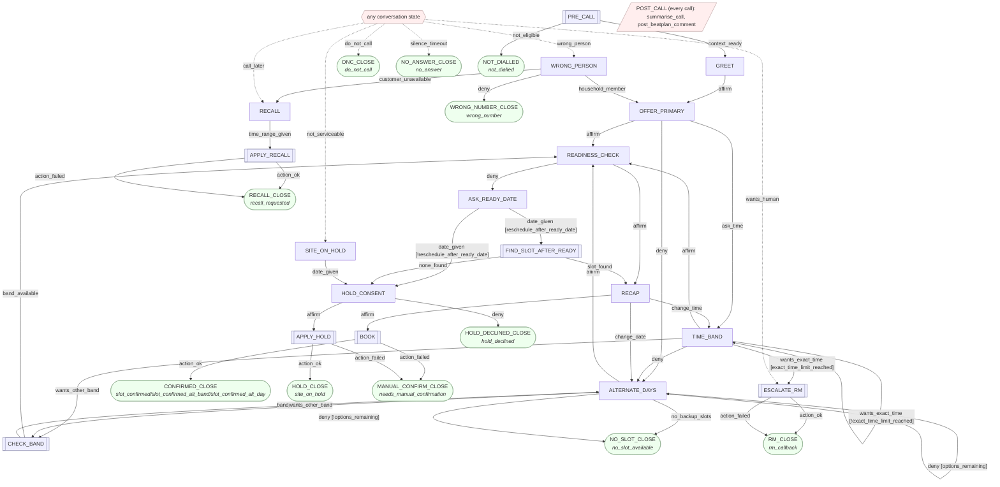

# Service Scheduling call flow (Beat Plan driven)

Ticket: **TECH-56** (Beat-Planing AI calling Epic) · Flow version: see `flow.yaml`

Beat Plan already soft-allocates every site due in the next 15 days to a Service Hero and a tentative date, with backup dates. This bot calls the customer, turns that soft allocation into a **confirmed slot**, a **site on hold**, or an **escalation**, and writes a summary back to Beat Plan on every call.

## How this folder works

| File | What it holds | Who edits it |
|---|---|---|
| `flow.yaml` | States, transitions, guards, outcomes. The state machine code runs. | Product + eng |
| `intents.yaml` | What the LLM classifies customer turns into, with Hindi/English example phrases. Global intents work from any state. | Product, native speakers |
| `actions.yaml` | Beat Plan / Zeus calls the flow triggers, with status `live` / `contract_pending` / `stub`. | Eng |
| `policies.yaml` | Tunable rules: time bands, options per turn, exact-time limit, readiness items, hold policy, calling hours. | Product / ops |
| `prompts/hi.yaml`, `prompts/en.yaml` | What the bot says in each state. | Product, native speakers |
| `schemas/` | Beat Plan input (`context`) and the record posted back (`call-record`). | Eng |
| `scenarios.yaml` | Paper-test calls with the expected outcome. Add one per new branch. | Anyone |

**Principle:** the state machine lives in config, the LLM handles language. The LLM classifies intent, extracts dates/times, and speaks the line. It never decides to book: `confirm_slot` is reachable only from `RECAP → BOOK`, and `site_on_hold` only after explicit consent.

### Changing the flow (from Claude Code or by hand)

1. Edit the YAML (e.g. "add a state that asks for gate access before RECAP").
2. Add or update a scenario in `scenarios.yaml`.
3. Run the checker and redraw the diagram:
   ```bash
   python3 -m venv .venv && .venv/bin/pip install -r tools/requirements.txt   # first time only
   .venv/bin/python tools/flowcheck.py --write
   ```
4. Bump `version` in `flow.yaml`, add a line to `CHANGELOG.md`, open a PR.

The checker fails if a transition points at a missing state, an intent/event/flag/action is undeclared, a state is unreachable, an outcome can't be produced, a spoken state lacks a Hindi or English line, the two languages have different prompt keys, a readiness item has no question, or any scenario ends in the wrong outcome.

## The call, in words

1. **PRE_CALL**: load the Beat Plan context. Don't dial if the customer is DNC, it's outside calling hours, or the number is not on the test allowlist.
2. **GREET**: name, "calling from SolarSquare", recording disclosure, identity check. Family member → can continue; doesn't know the customer → wrong number.
3. **OFFER_PRIMARY**: "Your maintenance is due, we have a slot on {date}. Will you be available?"
   - **Yes** → readiness check.
   - **Asks the time** → **TIME_BAND**: share the 4-hour band. If they want an exact time, say we can't guarantee it but will try (and log their preferred time). If they insist again → **RM callback**. If they want a different band that day → check Beat Plan: free → readiness; full → alternate days.
   - **Not that day** → **ALTERNATE_DAYS**: Beat Plan backup slots, closest first, 2 at a time. None fit → "no other slots now, team will reconnect".
4. **READINESS_CHECK**: A-type ladder, water source, light connection, one at a time. All yes → **RECAP** → **BOOK** (`confirm_slot`). Anything missing → ask by when it'll be ready → site on hold (or, if `on_missing_prereq: reschedule_after_ready_date`, first try a backup slot after that date).
5. **At any point**:
   - out of town / not serviceable → **SITE_ON_HOLD**: ask the date, then **explicit consent** ("you won't get calls from SolarSquare until then"). Yes → hold API. No → thank and close.
   - "call me later" → **RECALL**: ask a time range. The recall API doesn't exist yet (`stub`), so we post it as a Beat Plan comment and create a scheduler task.
   - asks for a person → **RM callback**. "Don't call me" → DNC. Price/technical questions → one-line deflection, stay in the step.
   - silence → no-answer close.
6. **POST_CALL** (every call, every outcome): LLM summary + structured record → Beat Plan comment.

## Outcomes (exactly one per call)

| Outcome | Meaning |
|---|---|
| `slot_confirmed` | Primary Beat Plan slot confirmed |
| `slot_confirmed_alt_band` | Same date, different 4-hour band |
| `slot_confirmed_alt_day` | Backup date confirmed |
| `site_on_hold` | Customer consented to hold until a date |
| `hold_declined` | Not serviceable, but declined the hold |
| `no_slot_available` | No primary/backup slot worked |
| `rm_callback` | Insisted on exact time, or asked for a person |
| `recall_requested` | Asked to be called later (window captured) |
| `do_not_call` | Asked not to be called |
| `wrong_number` | Not the customer and doesn't know them |
| `no_answer` | Silence / voicemail |
| `needs_manual_confirmation` | Customer agreed but the Beat Plan/Zeus API failed |
| `not_dialled` | Blocked before dialling (DNC, hours, allowlist) |

## Product notes

- **Missing readiness ≠ always hold.** If the ladder will be ready by Thursday and a backup slot exists after Thursday, rebooking beats holding. Switch with `on_missing_prereq` in `policies.yaml`; default is `site_on_hold` per the current spec.
- **Exact-time requests are signal.** `preferred_exact_time` is logged even when we don't escalate, so Beat Plan can learn and route heroes.
- **Holds must expire back into Beat Plan** on `hold_until`, or they become silent churn.
- **North-star metric:** % of Beat Plan sites confirmed on the first call. Also track hold rate, RM escalation rate, no-slot rate, average handle time, voice latency.

## Open questions (owner: Beat Plan / Zeus team)

- API contracts for `fetch_beatplan_context`, `check_band_availability`, `get_backup_slots`, `confirm_slot`, `site_on_hold`, `create_rm_callback`, `post_beatplan_comment` (all `contract_pending` in `actions.yaml`).
- Does Beat Plan allocate bands or exact times today?
- Retry policy for no-answer, and allowed calling hours per city.
- Who owns the recall API, and when will it exist?

## Flow diagram

Generated from `flow.yaml` by `tools/flowcheck.py --write`. Don't edit by hand. Blue = system step, green = end of call, red = applies everywhere.

<!-- flow-diagram:start -->

<!-- flow-diagram:end -->
